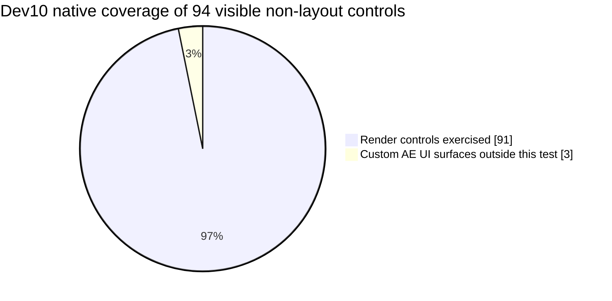

<h1 align="center">Reverie</h1>

<strong>Depth of field with the character of a lens.</strong> Adobe After Effects · Windows x64 · 3.3 dev10

<a href="https://github.com/zluxy/zlux.dof/releases/tag/v3.3.0-dev10">Download Reverie</a>

---

I built Reverie around the part I kept coming back to: a blur should look like it passed through glass. Set a radius and **Physical Lens** blurs the whole frame, no depth map required. If the shot needs selective focus, add a depth layer and place the focus point on your subject. The lens character stays yours to shape either way.

There is plenty to change when you want to get into the optics, especially the aperture. You do not have to start there.

<!-- IMAGE SLOT: docs/img/hero.png — one real shot rendered with Reverie. -->
> **Frame slot · Hero** — a finished shot will go here when its source and final render are ready.

## Make the first frame

|  | What to do |
| --- | --- |
| **Just blur** | Add Reverie and set **Blur Radius (px)**. Leave Depth Map empty. |
| **Choose focus** | Select **Depth Map (Optional)** and move **Focus Point** onto your subject. |
| **Give focus room** | Raise **In-Focus Width** when more of the subject should remain sharp. |
| **Shape the glass** | Choose one of 44 **Lens Looks**, then edit its values under **Aperture & Iris**. |

The iris can be round, bladed, curved, notched or rotated. You can use one of 80 aperture maps, a custom layer, and texture controls. **Lens Character** covers field curvature, cat's-eye clipping, aberrations and other optical behavior. **Highlights** shapes the light that survives defocus. Use **Draft** while working and **Final** or **Ultra** for the finished frame.

For a grayscale depth layer, start with point focus. For an EXR Z pass, first expose its Z channel as an After Effects layer, for example with EXtractoR, then feed that layer to Reverie. **Depth Input** lets you choose grayscale or Z if Auto guesses wrong, invert the direction, and adjust foreground fill. **Focus With → Slider** is there if you prefer an explicit value: 0–100 for grayscale, the raw distance for Z.

<!-- IMAGE SLOT: docs/img/before_after.png — same shot before and after. -->
> **Frame slot · Before / after** — the original shot beside its Reverie render.

<!-- IMAGE SLOT: docs/img/depth_triptych.png — source, actual depth layer, output. -->
> **Frame slot · With depth** — source, the depth layer actually used, and the result.

## What has been checked

The numbers below come from the native AE test host used for dev10. They describe the render code, not a full compatibility test inside every version of After Effects.

| Regression check | Result |
| --- | ---: |
| Full-resolution preset frames on two stereo EXR shots, with and without depth | **180 / 180** passed |
| CPU / CUDA image comparisons | **90 / 90** within the test tolerance |
| Directed preset switches checked for settings leaking between looks | **0 leaks in 1,936 switches** |

Dev10 also fixes highlight controls that looked active but did not change the frame as intended. **Bokeh Brightness Boost** and **Bokeh Gamma** now affect selected out-of-focus highlights. Tint and saturation work independently of Boost. Threshold endpoints, procedural iris obstruction and Smart Render data handling received fixes too.

## Where depth still needs care

A single image cannot show what is hidden behind a foreground object. Reverie extends nearby visible background under soft foreground edges, but that is an estimate. A bad depth edge or a large occlusion may still need a better map or manual cleanup. These tests also do not cover every AE timeline, GPU driver or third-party depth source.

<!-- IMAGE SLOT: docs/img/presets_grid.png — identical source and focus, several looks. -->
> **Frame slot · Lens comparison** — the same shot, focus and radius with several looks.

## Install

Download the [Windows release](https://github.com/zluxy/zlux.dof/releases/tag/v3.3.0-dev10). The ZIP includes `Reverie.aex`, `cudart64_12.dll` and an installer. Close After Effects, extract the ZIP and run `install-build.bat` as administrator. The installer backs up installed Reverie, Lensmith or zluxDOF binaries it replaces.

To install manually, put `build_out/Reverie.aex` and `build_out/cudart64_12.dll` together in a MediaCore plugin folder, for example `C:\Program Files\Adobe\Common\Plug-ins\7.0\MediaCore\Zlux\`. Restart AE and open **Effect → Zluxia → Reverie**. The standalone `.aex` is attached to the release if you already have the CUDA runtime. Without a compatible NVIDIA GPU, Reverie renders on the CPU.

This build targets Windows x64, an AVX2-capable CPU and After Effects 2022 or newer. It has a new effect identity and control layout: add a fresh instance to existing projects. Old Lensmith and earlier Reverie instances are not migrated.

---

Reverie is free for personal and commercial use. It is not open source; redistribution, resale and modification are not permitted. See [LICENSE.txt](LICENSE.txt).

Created by zlux / zluxia. Adobe and After Effects are trademarks of Adobe Inc.
