

  

<h1 align="center">Reverie</h1>

<strong>Depth of field with the character of a lens.</strong> For Adobe After Effects on Windows.

  
  
  
  
  

  <a href="https://github.com/zluxy/zlux.dof/releases/tag/v3.3.0"><strong>Download</strong></a> ·
  <a href="#start-with-the-image">Quick start</a> ·
  <a href="#more-frames-from-the-footage">Examples</a> ·
  <a href="#the-numbers">Test results</a> ·
  <a href="#installation">Installation</a>

---

## A lens first. Depth when you need it.

I built Reverie around the part I kept coming back to: a blur should look like it passed through glass. Set a radius and **Physical Lens** blurs the whole frame, no depth map required. When the shot needs selective focus, add a depth layer and place the focus point on your subject. The character of the lens is still yours to shape.

You can get started with just the radius. When you want to go further, there are 44 editable lens looks, 80 aperture maps, custom iris layers, blades, curvature, rotation, texture, cat's-eye clipping and highlight controls. The detailed controls stay out of the way until you need them.

## One real test frame

This CS:GO frame was used to check the Highlights fix. Both images come from the same source; the second frame was rendered by Reverie with its depth map. Click either image to inspect it at full size.

### Original frame

### Reverie 3.3.0

Show the depth layer used for this frame

The test uses **Cyclop 85mm f/1.5**, a **35 px** blur radius and a focus point on the subject. Highlight Boost is deliberately set to **200** with a lower threshold of **0**: this is an aggressive regression test for the repaired controls, not a recommended grade for every shot. The image was produced through the native render test host, not captured from the After Effects interface.

<!-- FUTURE IMAGE SLOT: assets/real-world-depth.png — source, actual depth layer and final render from one real-life shot. -->
<!-- FUTURE IMAGE SLOT: assets/lens-comparison.png — same source/focus/radius with several lens looks. -->

## More frames from the footage

These are synchronized beauty and depth passes from the CS:GO footage archive. I combined the world and player passes, then rendered the matching depth map through Reverie's native GPU test host. The source and result in each pair are the same frame; no generated imagery is used.

Six frames, six different lens looks: **Helios**, **Sony STF**, **Canon Dream**, **LOMO Anamorphic**, **Petzval** and **Cooke S4**. Each shot uses the preset that worked best for its composition, rather than one look across the whole gallery.

### A clear subject against the forest

**Take 0030, frame 1303 · Helios 44-2 58mm f/2 · 28 px radius.** Focus stays on the airborne player while the trees recede into the lens blur.

<a href="assets/forest-jump-source.jpg">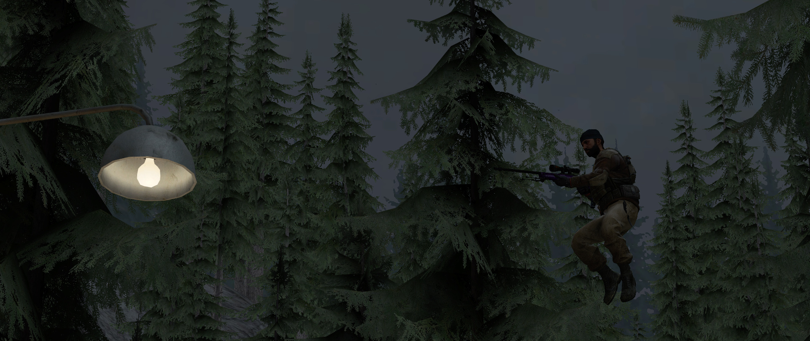</a> Original frame

<a href="assets/forest-jump-reverie.jpg">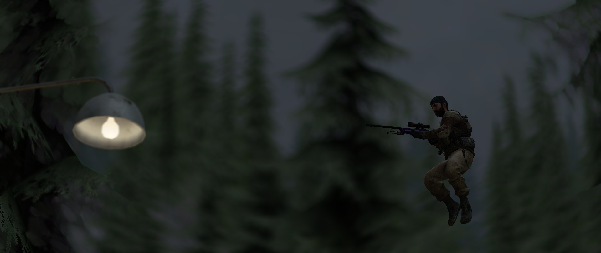</a> Reverie

Show this frame's depth map

<a href="assets/forest-jump-depth.png">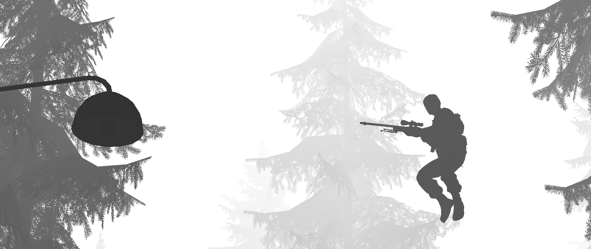</a>

### A close portrait in the courtyard

**Take 0032, frame 274 · Canon 50mm f/0.95 Dream · 55 px radius.** The gas mask and weapon stay in focus while the stonework behind them softens.

<a href="assets/castle-portrait-source.jpg">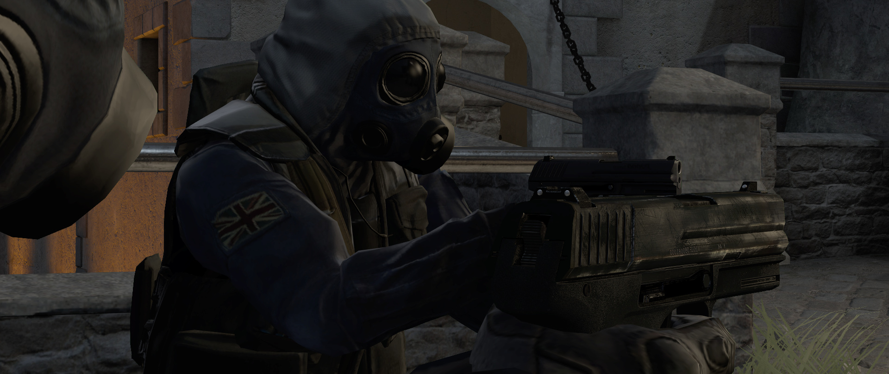</a> Original frame

 Reverie

Show this frame's depth map

<a href="assets/castle-portrait-depth.png">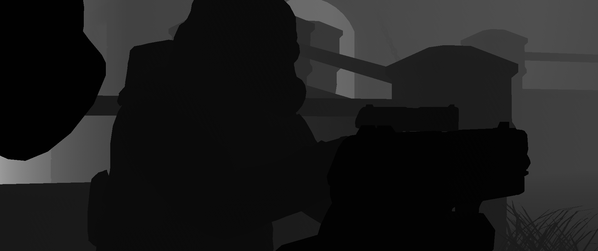</a>

### Metal and glass up close

**Take 0033, frame 631 · LOMO 35-NAP Anamorphic 2x · 55 px radius.** The foreground weapon remains crisp against the softer second player and wall.

<a href="assets/weapon-detail-source.jpg">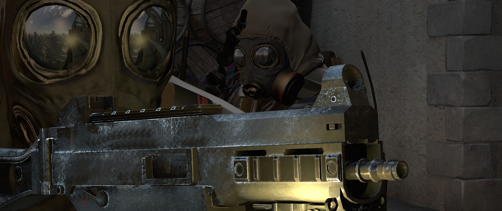</a> Original frame

 Reverie

Show this frame's depth map

<a href="assets/weapon-detail-depth.png">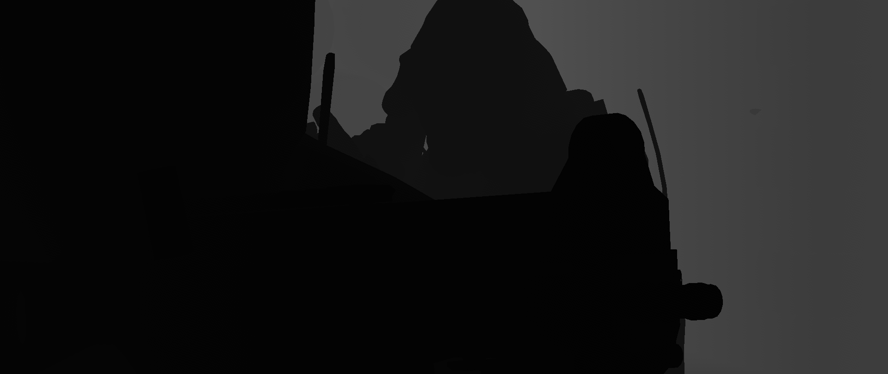</a>

### Two players at the barrels

**Take 0034, frame 517 · Petzval 85 (Lomography) · 28 px radius.** Focus stays on the nearer player while the teammate and timber backdrop recede.

<a href="assets/warehouse-team-source.jpg">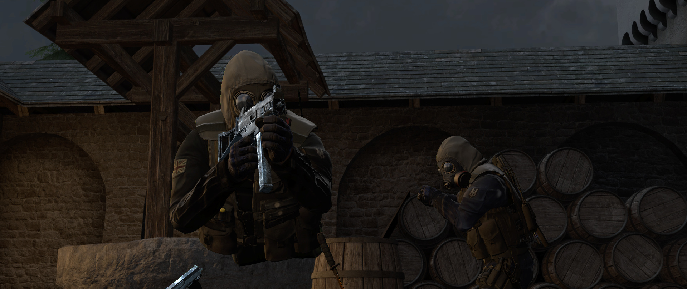</a> Original frame

<a href="assets/warehouse-team-reverie.jpg">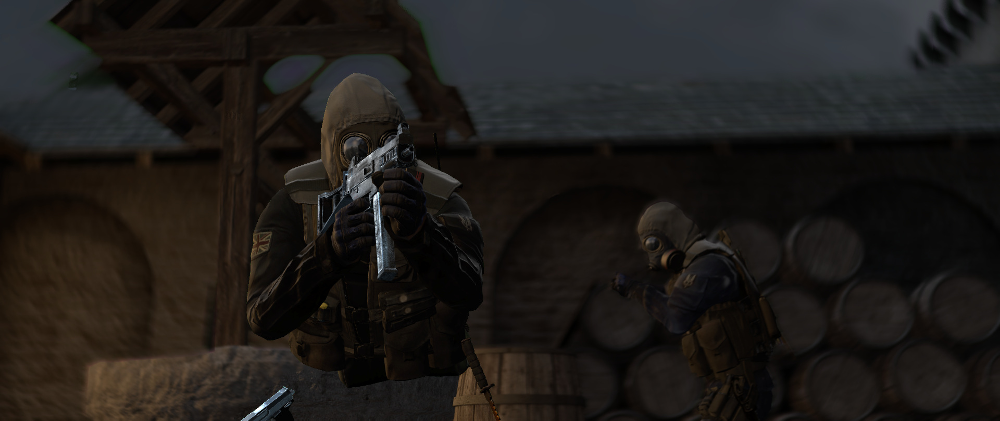</a> Reverie

Show this frame's depth map

<a href="assets/warehouse-team-depth.png">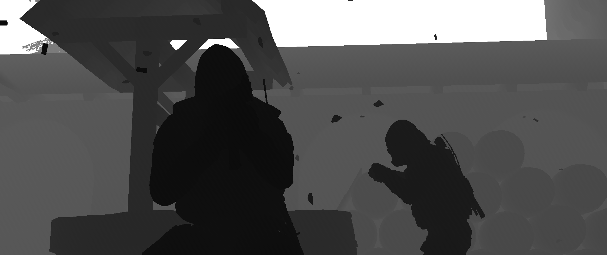</a>

### A team on the forest path

**Take 0035, frame 1099 · Cooke S4/i (Cine Warm) · 22 px radius.** The leading player reads clearly against the trees and teammates behind him.

<a href="assets/forest-team-source.jpg">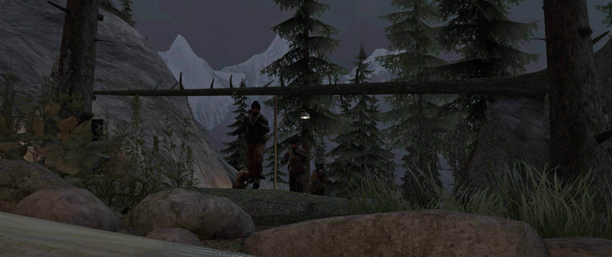</a> Original frame

<a href="assets/forest-team-reverie.jpg">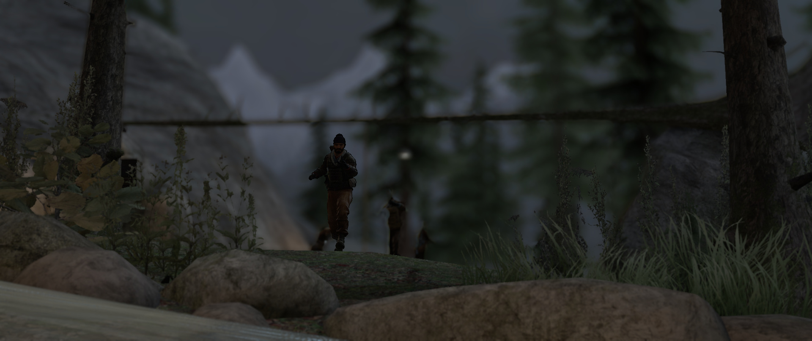</a> Reverie

Show this frame's depth map

<a href="assets/forest-team-depth.png">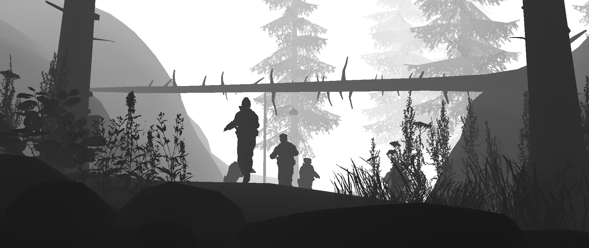</a>

### Focus across the stairwell

**Take 0016, frame 1470 · Sony 135mm STF (Apodized) · 18 px radius.** The nearby player remains defined while the room beyond the railing falls out of focus.

<a href="assets/stairs-source.jpg">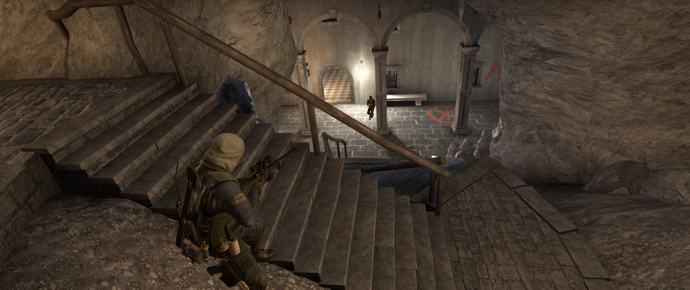</a> Original frame

<a href="assets/stairs-reverie.jpg">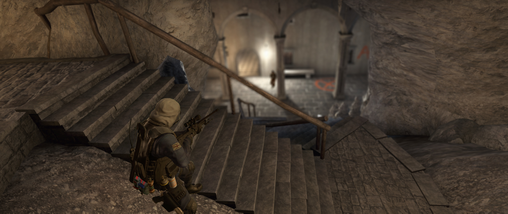</a> Reverie

Show this frame's depth map

<a href="assets/stairs-depth.png">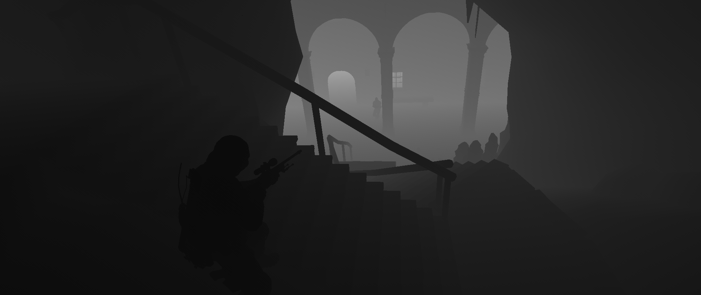</a>

## Start with the image

| Goal | First move |
| --- | --- |
| **Blur the whole frame** | Add Reverie and set **Blur Radius (px)**. Leave Depth Map empty. |
| **Keep a subject sharp** | Choose **Depth Map (Optional)** and move **Focus Point** onto the subject. |
| **Widen the sharp zone** | Raise **In-Focus Width**. Use **Show Focus** to see where focus lands. |
| **Change the look** | Pick a **Lens Look**, then tune its values under **Aperture & Iris**. |

For grayscale depth, point focus is the quickest route. For an EXR Z pass, first expose the Z channel as an After Effects layer, for example through EXtractoR, then select that layer in Reverie. **Depth Input** lets you choose grayscale or Z if Auto guesses wrong, invert the direction and adjust foreground fill. **Focus With → Slider** accepts 0–100 for grayscale or the raw distance for Z.

## The numbers

These native test-host results exercise the image-processing paths; they do not claim full compatibility with every After Effects version or timeline setup.

| Check | Result |
| --- | ---: |
| Full-resolution lens frames across both stereo EXR eyes, with and without depth | **180 / 180** passed |
| CPU / CUDA render comparisons | **90 / 90** within test tolerance |
| Directed lens-preset switches | **0 settings leaks in 1,936** checks |

This release fixes Highlights controls that appeared active but did not change the frame as intended. **Bokeh Brightness Boost** and **Bokeh Gamma** now affect selected out-of-focus highlights. Tint and saturation work without Boost. Threshold endpoints, procedural iris obstruction and Smart Render data handling received fixes too.

## Where depth still needs care

A single image cannot reveal what was hidden behind a foreground object. Reverie extends nearby visible background under soft foreground edges, but that is an estimate. A poor depth edge or a large occlusion may still need a better map or manual cleanup. The native tests above also do not cover every GPU driver, third-party depth source or interaction inside the full AE interface.

## Installation

Download the [Windows release](https://github.com/zluxy/zlux.dof/releases/tag/v3.3.0). The ZIP includes `Reverie.aex`, `cudart64_12.dll` and an installer. Close After Effects, extract the ZIP and run `install-build.bat` as administrator. The installer backs up installed Reverie, Lensmith or zluxDOF binaries it replaces.

To install manually, put `build_out/Reverie.aex` and `build_out/cudart64_12.dll` together in `C:\Program Files\Adobe\Common\Plug-ins\7.0\MediaCore\`. Restart AE and open **Effect → Zluxia → Reverie**. The standalone `.aex` is attached to the release if you already have the CUDA runtime. Without a compatible NVIDIA GPU, Reverie renders on the CPU.

This build targets Windows x64, an AVX2-capable CPU and After Effects 2022 or newer. It has a new effect identity and control layout: add a fresh instance to existing projects. Old Lensmith and earlier Reverie instances are not migrated.

---

Reverie is free for personal and commercial use. It is not open source; redistribution, resale and modification are not permitted. See [LICENSE.txt](LICENSE.txt).

Created by zlux / zluxia. Adobe and After Effects are trademarks of Adobe Inc.
